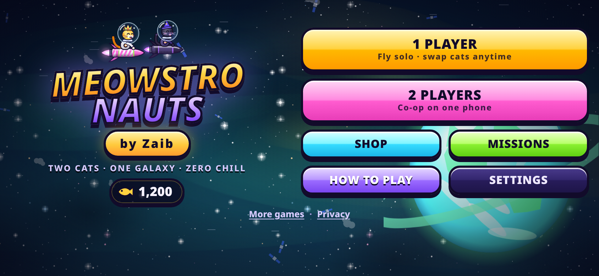
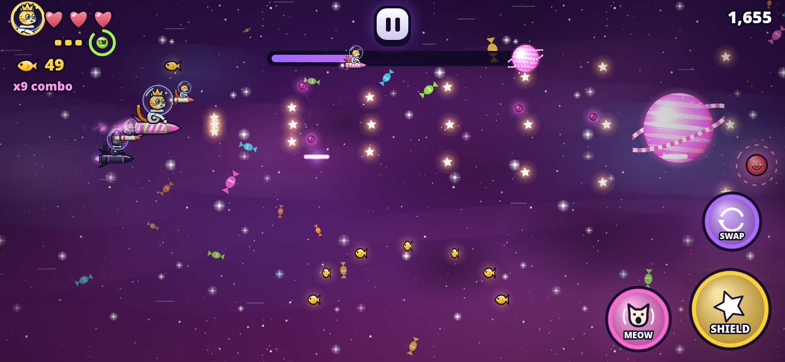
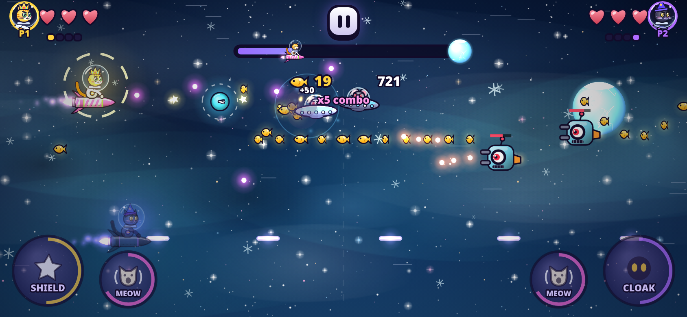
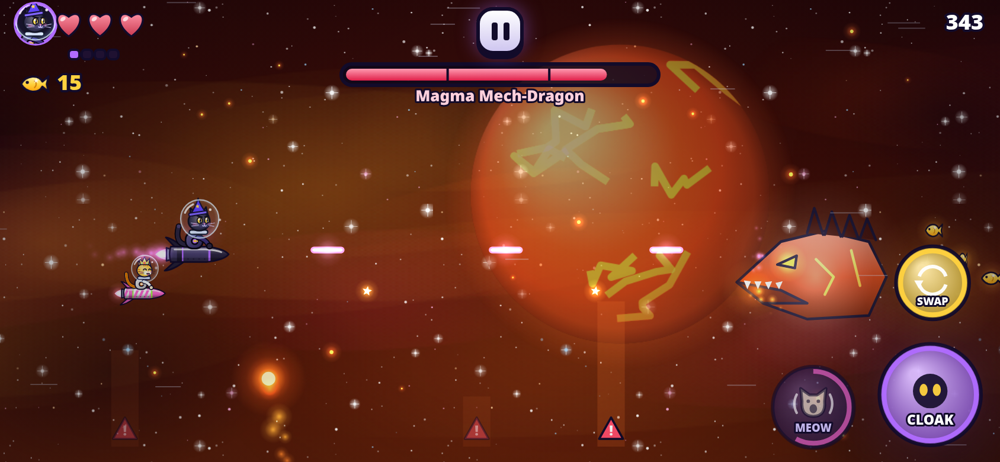

# Meowstronauts by Zaib

Two space cats, **Sunny** (yellow) and **Shadow** (black), fly their rockets across the galaxy to get home. It's a polished arcade space flyer/shooter for mobile browsers. Everything is in one self-contained HTML file: no libraries, no downloads, no ads.

**▶ Play now: https://zaibgames.com/meowstronauts/**

## Features
- **6 planets on a galaxy map**, each with its own look, music, hazards and boss:
  - **Moon Cheese**: cheese asteroids. Boss: The Big Cheese.
  - **Candy Planet**: donuts, gumdrops and spinning lollipops. Boss: Candy Kraken.
  - **Ice Comet**: falling icicles. Boss: Frost-Bot 3000, which fires ice beams.
  - **Lava World**: erupting fireballs. Boss: Magma Mech-Dragon.
  - **Black Hole**: gravity wells. Boss: Void Rat Emperor.
  - **Home: Purrth**: Boss: Mouse Mothership.
- **Two cats with different powers:**
  - Sunny is fast, fires spread star shots and has the **Sun Shield**, which blocks and reflects bullets.
  - Shadow fires heavy piercing lasers and has the **Shadow Cloak**, which phases through everything and ends in a burst.
  - In 1 Player, the other cat flies as a sidekick. **SWAP** any time; each cat has its own power cooldown.
- **2 Players co-op on one phone:** P1 drags on the left half and P2 on the right half, each with their own buttons (full multi-touch). If a cat is knocked out, fly into its bubble to rescue it.
- **Power-ups:** Mega Laser, Fish Magnet, Bubble Shield, Mega Meow shockwave, Mini-Cat drones, Extra Heart, Rocket Boost, Time Purr (slow-mo) and Double Shot.
- **Mega Meow meter:** collect fish stars to charge it, then unleash a screen-clearing meow.
- **Enemies:** space mice in saucers, robot gunners, kamikaze rocket rats, mines and mystery "?" UFOs that carry power-ups.
- **Progression:**
  - Collect fish stars and yarn balls.
  - Earn 3 stars per planet.
  - 18 missions.
  - Shop with 8 rocket upgrades, 12 costumes and 7 rocket skins, equipped per cat.
- **Endless Voyage:** cycles through all biomes with bosses and saves your best distance.
- **Easy controls:**
  - Drag anywhere to fly; auto-fire is on.
  - Optional floating joystick, manual fire and auto-ability.
  - Keyboard support.
- **Fair difficulty:** Easy, Normal and Hard. Every hazard is telegraphed with a warning. You can revive once per flight for fish.
- **Graphics:**
  - Parallax starfields and nebulae.
  - Shaded procedural art and cute animated cats with expressions.
  - Glow particles, screen shake and glossy menus.
- **Sound:** generated WebAudio music for each planet, plus synthesized meows and sound effects.
- **Performance:** delta-time 60 fps with automatic quality fallback. The game pauses when hidden. Progress saves in localStorage.

## Controls
| Touch | Action |
|---|---|
| Drag anywhere | Fly (the cat follows your finger's movement) |
| Big button | Cat power: Sun Shield / Shadow Cloak |
| MEOW | Mega Meow shockwave (when charged) |
| SWAP | Switch cats (1 Player) |
| 2 Players | Left half = P1 · right half = P2, buttons in each corner |

Keyboard (1P): WASD/arrows to fly, Space for the power, E for meow, Shift/Q to swap, P to pause. Keyboard (2P): P1 uses WASD + F/G and P2 uses the arrows + Enter/Right Shift.

Landscape is recommended; portrait also works.

---
Game by **Zaib** · [More games](https://zaibgames.com/) · [Privacy](https://zaibgames.com/privacy/)
